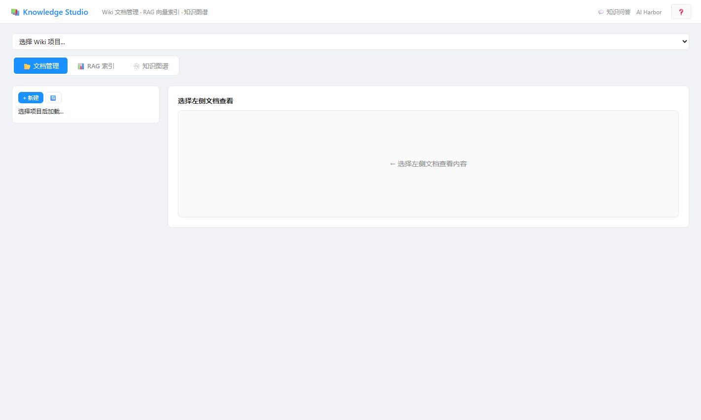

<p align="center">

</p>

# llm-wiki-builder — LLM 驱动的 Wiki 知识构建工具链

## 项目简介

**llm-wiki-builder** 是一套独立的知识构建工具链：把项目代码、文档、上传的 Word/PDF/Excel，用 LLM 加工成**结构化的 Wiki 知识库**——Markdown 页面 + 实体关系知识图谱 + RAG 向量索引，再通过 Wiki 问答与智能检索消费这些知识。Node.js 原生 http 服务 + 单文件前端页面，**零数据库**（wiki 目录即数据）、**零 CDN**（图表库全部本地化）。

- **问题域**：知识散落在代码注释、Word 文档、群聊记录里——人找知识靠翻文件，Agent 找知识没有结构化入口。直接把文档喂给大模型，上下文放不下、检索不精准、更新不同步。
- **方案机制**：**LLM Wiki 引擎**（ProjectScanner 扫描项目 → WikiEngine 生成页面 → CrossLinker 补 `[[双链]]` → WikiMaintainer 增量维护）、**Wiki 图谱化**（WikiGraphBuilder 从页面抽取实体与关系，vis-network 可视化）、**RAG 引擎**（chunker 分块 + 向量检索 + 图谱融合检索 GraphRAG）、**三级问答**（向量召回 → 图谱增强 → LLM 裁决）。
- **交付物**：`server.js` 单服务入口（默认 :3014）、4 组 API 路由族（约 90 端点含兼容别名）、6 个单文件工具页、105 KB 的 `llm-wiki-engine.js` 核心引擎、演示种子 3 库 54 页、测试套件。
- **状态**：从 AI Harbor 单体的 Knowledge Studio 剥离（wiki+RAG 端点子集），代码对齐宿主最新版。默认 `127.0.0.1:3014` + `SKIP_AUTH=true`，面向本机/内网；**不是生产就绪服务**，对外暴露前必须换认证。

> 写法参考（实调原文）：[Ollama](https://github.com/ollama/ollama) 的「2 行跑起来」、[Prometheus](https://github.com/prometheus/prometheus) 的「一段简介 + 加粗机制名清单」。风格与同系列仓库 [graph-builder](https://github.com/wanshoulu/graph-builder)（图谱构建 + RSI 进化）、ai-native-bank、Model-Builder 保持一致。

## 名词表

| 名词 | 含义 |
|------|------|
| **Wiki 项目 / 库** | `wiki/` 目录下的一个子目录，内含 Markdown 页面（`.md`），即一个独立知识库。库的发现是目录扫描式的：主根下含 `.md` 的目录自动成为可管理库。 |
| **LLM Wiki 引擎** | `tools/llm-wiki-engine.js`（105 KB）：`ProjectScanner` 扫描项目结构、`WikiEngine` 调 LLM 生成/重写页面、`GraphBuilder` 从 `[[双链]]` 构建页面关系图、`CrossLinker` 自动补链、`WikiMaintainer` 增量维护、`SearchEngine` 关键词检索。 |
| **Wiki 图谱化** | 从 Wiki 页面抽取**实体**（人物/系统/概念…）与**关系**，生成 `_wiki_graph.json`，vis-network 交互可视化；可选 LLM 语义增强与实体去重。 |
| **RAG / GraphRAG** | Retrieval-Augmented Generation：`chunker` 分块 → 向量化 → 相似召回；GraphRAG 在向量召回之上叠加图谱关系扩展（实体邻居、社区摘要）。 |
| **摄入（ingest）** | 把上传的 Word/PDF/Excel 转为 Markdown 原料，LLM 按文档规范（doc-rules）生成 Wiki 页面的流水线，SSE 流式返回进度。 |
| **[[双链]]** | Wiki 页面间的引用语法；`GraphBuilder` 用它构建页面关系图（哪些页面引用哪些）。 |
| **AI Harbor / Knowledge Studio** | 本项目剥离前的宿主：AI Harbor 是多工作台门户，Knowledge Studio（`routes/knowledge-studio.js`）是其统一知识 API（wiki + RAG + 评测 + MCP 的合并体）。本仓库取其 **wiki+RAG 子集**，MCP/评测数据集/公文审核端点不分发。 |

## 四条知识链路，一个引擎

| # | 链路 | 入口页面 | 后端 | 特点 |
|---|------|---------|------|------|
| 1 | **项目 → Wiki**（代码库知识化） | `/tools/llm-wiki.html` | `/api/knowledge/projects/scan` → `ingest` | 扫描项目目录 → LLM 按文档规范生成结构化页面（含双链） |
| 2 | **文档 → Wiki**（上传文档知识化） | `/tools/wiki-builder-standalone.html` | `/api/knowledge/ingest/generate-stream` | Word/PDF/Excel → Markdown → 三阶段 LLM 流水线，SSE 实时进度 |
| 3 | **Wiki → 图谱**（实体关系抽取） | `/tools/wiki-graph-builder.html` | `/api/knowledge/graph/generate-stream` | 页面文本 → 实体+关系图（LLM 增强/去重可选）→ vis-network 可视化 |
| 4 | **Wiki → 问答/检索**（知识消费） | `/tools/wiki-library.html` | `/api/knowledge/qa` · `search` · `rag/*` | 三级问答（向量 → 图谱增强 → LLM 裁决）；RAG 索引构建/预览/检索 |

四条链路共享同一份 wiki 数据（`wiki/` 目录 Markdown）与同一个 LLM 客户端（`config/api-keys.js` 模型路由注册表）。

## 快速开始（Node ≥ 18）

```bash
git clone https://github.com/wanshoulu/llm-wiki-builder.git
cd llm-wiki-builder && npm install && npm start
```

打开 <http://127.0.0.1:3014/> —— 根路径 302 到 `/tools/llm-wiki.html`（LLM Wiki 工作台）。改端口 `PORT=4014 npm start`；配密钥 `cp .env.example .env` 填 `DEEPSEEK_KEY` 等（**不配也能跑**：浏览、页面管理、关键词检索、图谱可视化全离线可用，生成/问答/RAG 需要 LLM）。

跑起来后验证：

```bash
curl http://127.0.0.1:3014/api/health
# → {"ok":true,"service":"llm-wiki-builder",...}

curl http://127.0.0.1:3014/api/knowledge/projects
# → {"success":true,"projects":[{"name":"doc-rules","pages":20},...]}   演示种子 3 库 54 页

curl -X POST http://127.0.0.1:3014/api/knowledge/search -H 'Content-Type: application/json' \
  -d '{"query":"反洗钱","project":"work-assistant"}'
# → {"success":true,"results":[...]}   关键词检索，离线可用
```

## 前端页面（原版设计、零 CDN）

| 页面 | 路径 | 作用 |
|------|------|------|
| **LLM Wiki 工作台（主入口）** | `/tools/llm-wiki.html` | 项目扫描 → Wiki 管理 → 浏览 → 知识图谱 → 智能检索，五合一 |
| **知识问答（Agent 应用）** | `/tools/knowledge-qa.html` | wiki 图谱问答 + GraphRAG 检索 + Agent 对话（Agent 通道需 `KNOWLEDGE_QA_AGENT_URL` 指向 Python 服务，未配置时该通道明确降级） |
| **公文审核（Agent 应用）** | `/tools/doc-review-agent.html` | 上传 Word/PDF → 规则 + LLM 双通道审核 → 批注定位与回写（公文规范知识库 `doc-rules` 驱动：文种格式/标点/禁用词/引文核查） |
| 知识库管理 | `/tools/wiki-library.html` | 库/页面 CRUD、RAG 索引构建、分块预览、图谱问答 |
| 文档 Wiki 化 | `/tools/wiki-builder-standalone.html` | 上传 Word/PDF/Excel → 三阶段生成流水线（SSE 进度） |
| Wiki 图谱化 | `/tools/wiki-graph-builder.html` | 实体关系抽取与可视化（LLM 增强/去重可选） |
| 轻量版 ×2 | `llm-wiki-light.html` / `wiki-graph-builder-light.html` | 同功能的精简皮肤版 |

> 知识问答与公文审核是 AI Harbor「基础工具 · AI 知识」区的两个 Agent 应用，与本仓库的知识链路同源（都消费 wiki 库与图谱），一并继承为 LLM Wiki 应用层；页面顶栏（appbar）在三者间互链。

## API 概览（完整契约见端点源码注释）

| 前缀 | 组 | 说明 |
|------|----|------|
| `/api/knowledge/` | projects / pages / raw / ingest / graph / qa / search / rag / queue / watcher | Wiki 主体全部端点 |
| `/api/llm-wiki/*` | 兼容别名 | 老前端页面用的路径（`scan`→`projects/scan` 等，studio 内部映射） |
| `/api/wiki-graph/*` | 兼容别名 | 图谱化 SSE（`generate`/`data`） |
| `/api/knowledge-builder/wiki/` | libraries / runs | 库 CRUD（创建/归档/恢复/删除）与构建运行管理（断点恢复） |

## 仓库结构

```
llm-wiki-builder/
├── server.js                    # 入口：4 组路由分发 + 静态托管 + 根路径 302（默认 :3014）
├── config/api-keys.js           # 模型路由注册表（LLM 调用单一出口）
├── middleware/auth.js           # JWT 认证（SKIP_AUTH=true 免登录）
├── routes/
│   ├── knowledge-studio.js      # Wiki+RAG 主体（从单体合并版取子集，69 端点中分发 wiki 相关 ~40）
│   ├── knowledge-studio-lite.js # 知识问答页两端点精简版（pages/get 兜底）
│   ├── knowledge-builder-wiki-*.js  # 库 CRUD / 构建运行 / 评审 / 存储层（4 文件）
│   ├── knowledge-qa-api.js     # 知识问答应用端点（GraphRAG/图谱问答/模型列表）
│   └── knowledge-builder-runtime.js # 构建运行时（181 KB，懒加载）
├── tools/
│   ├── llm-wiki-engine.js       # 核心引擎（105 KB：Scanner/Engine/Graph/CrossLink/Maintainer/Search）
│   ├── rag-engine.js / chunker.js          # RAG 分块与向量检索
│   ├── wiki-graph-builder.js / wiki-manifest-index.js   # 图谱化与清单索引
│   ├── knowledge-wiki-qa-service.js / knowledge-rag-answer-service.js  # 问答服务
│   ├── knowledge-qa-agent/     # Python 问答 Agent（OpenJiuwen DeepAgent + 5 图谱工具，:8100，可选进程）
│   ├── wiki-build-agent/       # Python 构建引擎（FastAPI + skills + SSE 8 事件契约，可选进程）
│   └── *.html ×8 + vendor/     # 前端页面 ×8（vis-network/G6/marked/phosphor 全本地化）
├── scripts/                     # graph-generator 链（图谱化 LLM 生成）
├── wiki/                        # 演示种子 3 库 54 页（doc-rules / work-assistant / llm-agent）
├── data/                        # knowledge-builder 运行数据（gitignore 生成物）
└── tests/                       # test-llm-wiki-maintainer.js
```

## 已知限制

- **默认免鉴权**：`SKIP_AUTH=true` + 绑定 `127.0.0.1`；对外暴露前必须设 `SKIP_AUTH=false` + `JWT_SECRET`。
- **LLM 能力需密钥**：生成/问答/图谱语义增强在未配置密钥时返回明确降级（qa 会退化为检索结果列表）；浏览/检索/图谱可视化离线可用。
- **不含单体的大块能力**：MCP 工具协议、评测数据集、意图测试集、知识看板（analytics）不在本仓库分发范围——它们属于 AI Harbor 的其他工作台。公文审核与知识问答两个 Agent 应用已随本仓库继承。
- **老 API 兼容**：`llm-wiki-api.js` / `wiki-graph-api.js` 在单体已标记 deprecated 并合并入 Knowledge Studio，本仓库直接采用合并版并保留 `/api/llm-wiki/*` 兼容别名。
- **RAG 向量索引**：无密钥时退化为关键词检索；向量通道需要 embedding 模型密钥。

## 常见问题

**没有模型 Key 能体验吗？** 能：3 个演示库 54 页可浏览，页面读写、关键词检索、图谱可视化全部离线；生成与问答需要配 Key。

**和 graph-builder 什么关系？** 同一系列的两个独立工具：graph-builder 把原料加工成**结构合法的属性图**（模板驱动校验、版本链）；本仓库把原料加工成 **Wiki 知识库**（Markdown + 双链 + RAG）。两者数据模型不同、互不依赖，可同时部署（端口 3013/3014 相邻）。

**数据存在哪？** 全部在 `wiki/` 目录（Markdown 文件即知识库）与 `data/knowledge-builder/`（库元数据、RAG 索引缓存）。拷走 `wiki/` 即备份知识本身。

## 版本

| 版本 | 说明 |
|------|------|
| **1.1.1**（当前） | 全面复审补漏：继承 wiki-build-agent（66 文件 Python 构建引擎，FastAPI + skills + SSE 8 事件契约）与 knowledge-qa-agent（12 文件 Python 问答 Agent，OpenJiuwen DeepAgent）；marked/G6 CDN 本地化（离线完备）；修复 qa-api 未接管网址挂起 bug（秒回 404） |
| 1.1.0 | 补齐 AI Harbor「AI 知识」区两个 Agent 应用：知识问答（GraphRAG + qa-agent 代理通道）与公文审核（规则+LLM 双通道 9 端点）；前端恢复单体原版设计（深浅双主题并存是原设计特性）；phosphor 图标与 appbar 顶栏补齐 |
| 1.0.0 | 从 AI Harbor Knowledge Studio 剥离 wiki+RAG 子集：6 前端页、CDN 本地化；修复源仓自带的 standalone 模板字符串转义笔误（6 处语法错误）；演示种子 3 库 54 页；六页无头浏览器实测 0 异常 |

## 许可证

[MIT](LICENSE)
